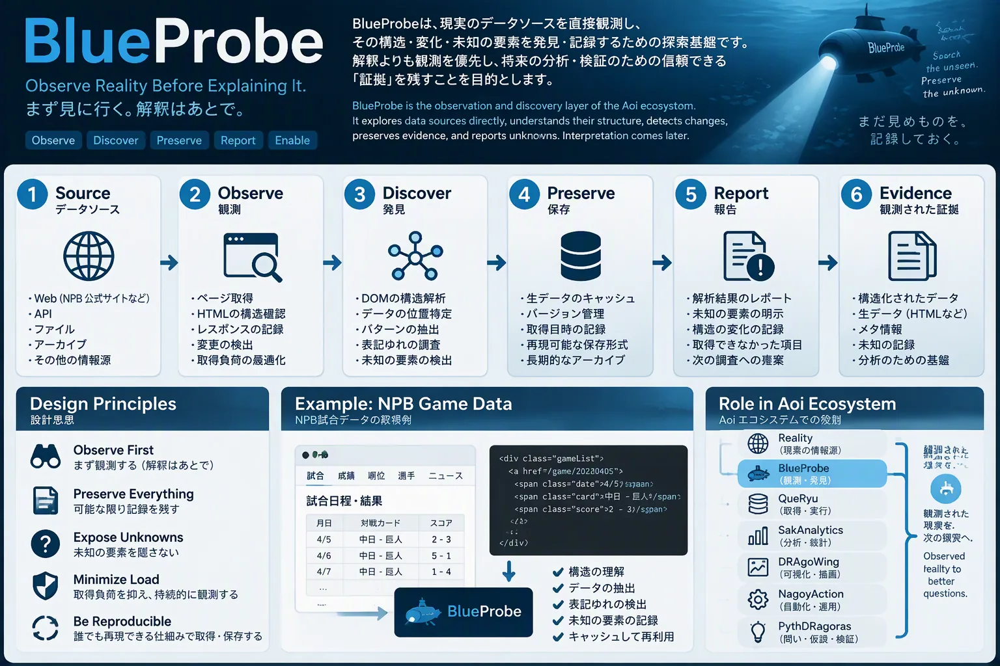

# BlueProbe

> まず見に行く。解釈はあとで。



*イメージ図（構想を共有するための図。実際のデータ・HTML構造ではない）*

## 概要

BlueProbe は、取得済みの Web ページ（HTML/CSS/DOM）を読み、**何がそこにあるか**を記録する観測・抽出のツールです。勝敗や原因の判断はしません。

- 取得元に依存しない部分（表記の正規化、報告の契約、キャッシュだけを読むオフライン再解析）を `blueprobe.py` に置きます。
- 取得元ごとの読み方は別モジュール（`<name>.py`）に分け、`pages()` と `parse()` を書けばそのまま使えます（下の「取得元を足す」）。
- 採用したものだけでなく、採用しなかったものの件数と、どの区分にも当たらなかった原文（`unknown`）も返します。
- 再解析ではネットワークに出ません。取得は [QueRyu](https://github.com/myon-bioinformatics/QueRyu) が担い、BlueProbe はその保存本文を読みます。

保存済みWeb画面の座標・操作履歴をブラウザなしで整理する入口は
[`web_observations.py`](docs/web-portability.md)。Dart／Kotlin／Swiftのソースと
ビルド設定のハッシュ一覧も作れる。保存観測の解析と、現在の実装の実行検証は区別する。

[Aoi](https://github.com/myon-bioinformatics/Aoi) のサブプロジェクト [`blueprobe/`](https://github.com/myon-bioinformatics/Aoi/tree/main/blueprobe) から独立したリポジトリです（下の「Aoi との関係」）。

## インストールと使い方

Python 3.11 以上と [uv](https://docs.astral.sh/uv/) を使います。実行時の依存は `selectolax` だけです（`pyproject.toml`）。

```bash
git clone https://github.com/myon-bioinformatics/BlueProbe.git
cd BlueProbe
uv sync
uv run python blueprobe.py --source <取得元のモジュール名> --cache <QueRyu のキャッシュ> --out observed.md
```

キャッシュだけを読み、ネットワークには出ない。未知の表記があれば件数を表示する（`--strict` で終了コード1）。

## 構成

| ファイル | 役割 |
|---|---|
| `blueprobe.py` | 取得元に依存しない部分: 正規化、報告の契約、オフライン再解析（`inspect`） |
| `html_source.py` | 保存HTMLを、信頼したオフライン抽出関数へ渡す汎用の取得元（`HtmlSource`） |
| `snapshot_source.py` | 保存済み本文の供給元の契約（`SnapshotSupplier`）と QueRyu 用アダプタ（`QueRyuCacheSource`） |
| `web_observations.py` | 保存済みWeb画面の観測とソース一覧の整理（ブラウザ・SDKなし） |
| `docs/contract/v1/` | 報告と snapshot 記録の契約（追加はv1のまま、破壊的変更はv2） |
| `docs/boundaries.md` | BlueProbe / QueRyu / web-ui の責務の境界（提案） |
| `docs/antipatterns.md` | 繰り返しそうな失敗とその約束 |
| `tests/cases/*.jsonl` | 表記揺れのコーパス（xprobe と同じ id / category / value / reason 形式） |

NPB（日本プロ野球）向けの取得元は、後半の「NPB（プロ野球）の取得元」にまとめています。

## 取得元を足す

`<name>.py`（Aoi では `blueprobe/<name>.py`）に次の2つを書けば、QueRyu と `inspect` からそのまま使える。

```python
def pages(scope) -> list[tuple[str, str, str]]: ...   # (key, url, group)
def parse(html: str, url: str) -> dict: ...          # new_report() の形で返す
def check(records) -> list[str]: ...                 # 任意。既知値との照合
```

正規表現は狭く、全体一致で書く。新しい表記を見つけたら、広げる前にコーパスへケースを足す。

## 報告の契約

1ページを読んだ結果は、採用したものだけでなく、採用しなかったものも返す。

```text
records : 採用した観測（原文と派生値を並べる）
counts  : 採用しなかったものの区分ごとの件数（例: cancelled, non_regular）
unknown : どの区分にも当たらなかったもの。原文を残す → 表記の変化を疑う
```

## テスト

```bash
PYTHONPATH=<Aoi のルート>/queryu uv run pytest -q
```

キャッシュ連携テストは QueRyu（`Aoi/queryu`）を使う。CI（`.github/workflows/ci.yml`、Python 3.11–3.14）は Aoi を固定 SHA（`AOI_SHA`）で `.test-deps/aoi` に checkout し、
`PYTHONPATH` に `queryu` を足す。任意の lab 統合テストは後半の「固定した実装でオフライン統合テストを再現する」。

## Aoi との関係

このリポジトリは [Aoi](https://github.com/myon-bioinformatics/Aoi) のサブプロジェクト
[`blueprobe/`](https://github.com/myon-bioinformatics/Aoi/tree/main/blueprobe) から、履歴を保ったまま独立させたもの。
Aoi 側の `blueprobe/` とは `git subtree` で同期し続ける（どちらで変更しても、もう一方へ反映する）。
登録は他の subtree 子と同様、[Aoi](https://github.com/myon-bioinformatics/Aoi) 直下の [`child-heads.json`](https://github.com/myon-bioinformatics/Aoi/blob/main/child-heads.json) に載せます。親 [myon-bioinformatics](https://github.com/myon-bioinformatics/myon-bioinformatics) の `child-heads.json` には登録しません。Aoi と BlueProbe のあいだでは vendor lock を使いません（一覧と手順は Aoi の [docs/child-repositories.md#blueprobe](https://github.com/myon-bioinformatics/Aoi/blob/main/docs/child-repositories.md#blueprobe)）。

独立の目的は、HTML/CSS/DOM の構造を見て観測・抽出する知見を、リポジトリ横断でここに集めること。
BlueProbe の実行コードは他リポジトリの実装に依存せず、必要な情報は参照先と契約を揃えて扱う。
各リポジトリ側でのリファクタリングはそれぞれで行ってよい。

### 同期

```bash
# BlueProbe → Aoi（Aoi のルートで。子の main を `blueprobe/` に取り込む）
git subtree pull --prefix=blueprobe https://github.com/myon-bioinformatics/BlueProbe.git main
```

Aoi → BlueProbe・登録した `sha` の更新は、上の child-repositories の BlueProbe 節に従います。

`pyproject.toml`・`conftest.py`・`docs/images/`・`.github/` は独立リポジトリ側だけのファイル。

## 関連サブプロジェクト

親の [Aoi](https://github.com/myon-bioinformatics/Aoi) のサブプロジェクトは、それぞれ独立したリポジトリになっています。Aoi の中の場所（subtree）とあわせて載せます。一覧と登録の詳細は Aoi の [docs/child-repositories.md](https://github.com/myon-bioinformatics/Aoi/blob/main/docs/child-repositories.md) です。

| リポジトリ | Aoi の中の場所 | 役割 |
|---|---|---|
| **BlueProbe**（このリポジトリ） | [`blueprobe/`](https://github.com/myon-bioinformatics/Aoi/tree/main/blueprobe) | 観測と抽出（保存した HTML/CSS/DOM を読み、何があるかを記録する） |
| [QueRyu](https://github.com/myon-bioinformatics/QueRyu) | [`queryu/`](https://github.com/myon-bioinformatics/Aoi/tree/main/queryu) | 取得と観測データセットの作成（来歴つきのキャッシュ） |
| [SakAnalytics](https://github.com/myon-bioinformatics/SakAnalytics) | [`sakanalytics/`](https://github.com/myon-bioinformatics/Aoi/tree/main/sakanalytics) | 観測データからの指標と統計（チーム×シーズンの指標、残り試合の見通し） |
| [PythDRagoras](https://github.com/myon-bioinformatics/PythDRagoras) | [`pythdragoras/`](https://github.com/myon-bioinformatics/Aoi/tree/main/pythdragoras) | 説明の検証（命題・反例・異議あり） |
| [NagoyAction](https://github.com/myon-bioinformatics/NagoyAction) | [`nagoyaction/`](https://github.com/myon-bioinformatics/Aoi/tree/main/nagoyaction) | パイプラインの実行と自動化（同じ定義をローカルと GitHub Actions で） |
| [DRAgoWing](https://github.com/myon-bioinformatics/DRAgoWing) | [`dragowing/`](https://github.com/myon-bioinformatics/Aoi/tree/main/dragowing) | 図とレポート（Plotly.js の HTML、四つの形の表） |

## 参照・整合する関連リポジトリ

| リポジトリ | 見るところ | 内容 |
|---|---|---|
| [mcp-toolcall-lab](https://github.com/myon-bioinformatics/mcp-toolcall-lab) | `src/mcp_toolcall_lab/adapters/html_snapshot.py`, `css_inspect.py`, `source_access.py`, `docs/source-access.md` | 保存HTMLのオフライン抽出・CSS検査・取得元アクセス（SHA で固定して任意接続） |
| [browser-test-kit](https://github.com/myon-bioinformatics/browser-test-kit) | `scripts/page_text.py`, `examples/capture_browser_dom.py`, `docs/dom-capture.md`, `fixtures/page_text/` | ページ本文抽出とブラウザDOM採取 |
| [web-ui](https://github.com/myon-bioinformatics/web-ui) | `docs/local-dom-lab.md`, `tool/serve_dom_lab.py`, `tests/integration/test_gradio_dom.py` | ローカルDOMラボと DOM 証跡 |
| [flutter_navigation_basic](https://github.com/myon-bioinformatics/flutter_navigation_basic) | `e2e/tests/*.spec.ts` | Flutter Web 画面の DOM 観測（Playwright） |

揃え方: 参照先で新しい抽出の工夫や失敗を見つけたら、まずここのコーパス（`tests/cases/`）か `docs/antipatterns.md` に観測として残し、それから実装を合わせる。

## ライセンス

MIT License（[LICENSE](LICENSE)）。Aoi の `LICENSE` と同じ内容です。

## 今後の検討

他リポジトリが、BlueProbe の中核となる表記正規化・抽出の関数だけを最小の単一ファイルモジュールとして置く可能性はある。
その場合でも、このリポジトリ全体を vendor することはしない。現時点では未定。

---

# 詳しい使い方とNPB向けの内容

## 保存HTMLの共通抽出へ接続する

`html_source.HtmlSource(selector=..., extractor=...)` は、取得済みHTMLを信頼した
オフライン抽出関数へ渡し、既存の `inspect()` の報告形式に変換する。
取得・キャッシュ・NPB固有の観測は引き続き既存モジュールが担当する。
抽出できない構造は `extraction_failed` と原文付き `unknown` に残す。
同じページの抽出条件変更や再実行では、リンク先・CSSを含めて通信しない。

```python
from html_source import HtmlSource
from mcp_toolcall_lab.adapters.html_snapshot import extract

source = HtmlSource(selector="main#calendar > .day", extractor=extract)
rows = inspect(source, saved_pages, records_out)
```

上記はマージ済みの lab PR [#110](https://github.com/myon-bioinformatics/mcp-toolcall-lab/pull/110)・
[#111](https://github.com/myon-bioinformatics/mcp-toolcall-lab/pull/111) の抽出関数を使う任意の接続例。
BlueProbeはそのパッケージを自動インストールしない。通常のNPB解析に新しい依存はない。
`--source html_source` はlabの抽出モジュールが利用可能な環境でgeneric抽出を行う。
selectorはタグ、`#id`、`.class`、子要素 `>`、子孫の限定的な構文で、
CSSの描画・JavaScript実行・HTML5ブラウザDOM再構築を意味しない。
全CSS構文への対応やPages上のPython実行は保証しない。

### 検証済みキャッシュから snapshot を再利用する

供給元は差し替えられる（契約は [docs/contract/v1/snapshot.md](docs/contract/v1/snapshot.md)）。
任意の供給元は `inspect_snapshots(source, supplier)`、QueRyu は `inspect_queryu_cache`。
旧名 `inspect_cache` は互換のため残す（非推奨）。

`inspect_queryu_cache(source, cache, entries=None, records_out=None)` は QueRyu の照合済み
本文を読む。既定では最新行、`entries` を指定すると選んだ取得時点の行を使う。
NPB parser には原文HTMLをそのまま渡す。snapshot対応の `HtmlSource` には
`Cache.snapshot()` の envelope を渡し、既存の
`mcp_toolcall_lab.source_access.extract_snapshot` で検証・抽出する。
独自 validator や HTML parser は増やさない。
ここでの再解析はHTML構造の抽出・観測値の読み取りを指す。集計・指標計算は
[SakAnalytics](https://github.com/myon-bioinformatics/SakAnalytics)、仮説評価は
[PythDRagoras](https://github.com/myon-bioinformatics/PythDRagoras) が担う。

```python
from blueprobe import inspect_queryu_cache
from html_source import HtmlSource
from queryu import Cache

records = []
rows = inspect_queryu_cache(HtmlSource(selector=".calendar a"), Cache("data/raw/npb_calendar"),
                     records_out=records)
```

`--source html_source --cache ...` の CLI もこの経路を使う。
`derived` は従来の抽出結果を維持し、`snapshot` に共有検証が返す属性、
`cache_entry` に元の来歴を残す。任意の注入関数は
`HtmlSource(snapshot_extractor=...)` で明示する。引数は snapshot 辞書と抽出条件、
戻り値は lab と同じ `snapshot` / `extraction` の辞書。
従来の `parse(html, url)` / `extractor=...` は raw HTML 用として残し、
保存済みバイトの照合を行ったことにはしない。

QueRyu の hash/長さ不一致は抽出前にエラーで止まり、欠けた過去本文を自動取得しない。
lab は schema・URL形式・上限サイズ・decoded content hash を検査するが、
URLや取得時刻の真実性・応答の真正性までは検証しない。来歴が不明なら不明のまま残す。
ソースcheckout・CI runner identityの実行管理は NagoyAction 側の責務であり、
BlueProbe runtime に checkout検証や runner は追加しない。

### CSSを読む・既存NPB解析と比べる

`HtmlSource(include_css=True, stylesheets={saved_url: saved_css}, extractor=extract)`
で埋め込み・inline・明示した保存CSSの宣言を読む。色番号、CSS変数、重要指定、
条件付きルール、selectorとHTML要素の一致をderived側に残す。
外部stylesheetと@importは取得せず未読参照として残す。CSSごとのハッシュも残す。
未対応selectorはunsupported、一致なしはunmatchedと区別する。
表示色・継承・詳細度・変数解決・画面サイズ条件は計算せず、computed_stylesはfalse。
CSSが読めたことを、画面を再現できたこととして扱わない。

`html_compare.compare_calendar()` は、保存HTMLからselectorで読んだリンク群と、
既存 `npb_calendar.parse()` が採用した試合URLを比較する。
採用試合の欠落、リンク重複、抽出失敗を返す。元HTMLをNPB parserにそのまま渡すので、
大会見出し・中止・未知表記の判定は既存処理が保持する。
`complete_for_adopted_games` は既存parserが採用した試合に対する被覆だけを意味し、
parser自身が未知の試合を取りこぼしていないという証明ではない。
NPB保存fixtureの4試合・中止1件・非公式戦1件を用いて比較する。
同じ原文を何度再解析しても新規GETはしない。labなしの通常NPBテストは従来どおり動く。

### 固定した実装でオフライン統合テストを再現する

CI の `Offline lab integration (Python 3.14)` は、lab のマージコミット
`6a3fe3aac7e5ae939d2fe2720dfae002d5f0dd90` を `.test-deps/lab` に別途 checkout する。
`src` をテスト時の `PYTHONPATH` に追加し、事前確認で SHA と
`html_snapshot`・`css_inspect`・`source_access` の import 元を照合する。import 元は
実テスト内でも確認する。単一ファイルのコピー、lab の自動インストール、実行時の取得はしない。
通常の Python 3.11–3.15 のテスト行列は lab なしで維持し、統合テストは 3.14 のみで行う。
全 Python 版での lab 統合を検証したという意味ではない。

このリポジトリのルートで実行する（Aoi では Aoi のルートで、テストパスに `blueprobe/` を付ける）（clone はテスト前の準備で、抽出中の通信ではない）。

```bash
git clone https://github.com/myon-bioinformatics/mcp-toolcall-lab.git .test-deps/lab
git -C .test-deps/lab checkout --detach 6a3fe3aac7e5ae939d2fe2720dfae002d5f0dd90
test "$(git -C .test-deps/lab rev-parse HEAD)" = 6a3fe3aac7e5ae939d2fe2720dfae002d5f0dd90
export AOI_LAB_SOURCE_ROOT="$PWD/.test-deps/lab/src"
export PYTHONPATH="$AOI_LAB_SOURCE_ROOT"
uv run --python 3.14 python - <<'PY'
import os
from pathlib import Path
from mcp_toolcall_lab.adapters import css_inspect, html_snapshot
from mcp_toolcall_lab import source_access
root = Path(os.environ['AOI_LAB_SOURCE_ROOT']).resolve()
for module in (html_snapshot, css_inspect):
    expected = root / 'mcp_toolcall_lab/adapters' / (module.__name__.rsplit('.', 1)[1] + '.py')
    assert Path(module.__file__).resolve() == expected, module.__file__
assert Path(source_access.__file__).resolve() == root / 'mcp_toolcall_lab/source_access.py'
PY
uv run --python 3.14 pytest -q --require-lab-integration \
  tests/test_blueprobe_html_source.py::test_optional_real_lab_extractor_reuses_all_calendar_rows \
  tests/test_blueprobe_html_compare.py::test_real_saved_npb_fixture_coverage_and_css \
  tests/test_blueprobe_html_source.py::test_verified_cache_real_lab_snapshot_replay \
  --junitxml=build/test-results/lab-integration-3.14.xml
# lab ありの全テスト
uv run --python 3.14 pytest -q --require-lab-integration
# lab なしの通常テスト。別途 lab をインストールしていない環境で実行する。
unset PYTHONPATH AOI_LAB_SOURCE_ROOT
uv run --python 3.14 pytest -q
```

`--require-lab-integration` は実 extractor の3テストを必須にし、未収集・skip・
import 失敗を成功扱いにしない。通常モードでは lab がない場合のみ任意統合の3件を skip する。
これらのテストは socket 接続を遮断し、31行の抽出、保存 NPB HTML の4試合の被覆、
重複、中止1件・非公式戦1件、保存外部 CSS、未対応 selector、再実行の一致を検証する。
外部 CSS のリンクや `@import` を自動取得しないことも確認する。
統合 JUnit は失敗時も保存し、集約側は通常5件と統合1件の計6レポートを必須にする。

以下は PR #15 時点の過去のローカル検証（2026-10-09、Python 3.14.8、固定 lab SHA、Aoi の locked 依存）:

- 実 extractor の必須2テスト: 2 passed / 0 skipped
- lab ありの全テスト: 533 passed / 24 skipped
- lab なしの全テスト: 531 passed / 26 skipped

共通の24 skip は任意の season simulator 用依存がないためで、この統合とは別のもの。
当時の lab なしではさらに実 extractor の2テストを skip した。初回 PR 本文の `284 passed` は
過去の検証記録であり、現在の全テスト件数として扱わない。CI の結果は
[PR #15](https://github.com/myon-bioinformatics/Aoi/pull/15) の最新実行で確認する。

## NPB（プロ野球）の取得元

| ファイル | 役割 |
|---|---|
| `npb_calendar.py` | 取得元: npb.jp の月別公式戦カレンダー |
| `docs/npb_calendar.md` | その取得元で、どの年の何を確認したか（観測と未確認を分ける） |
| `npb_team_annual.py` | 取得元: npb.jp の年度別チーム表（1950年以降の要約、2005年以降の詳細表） |
| `npb_team_batting.py` | 取得元: npb.jp の年度別チーム打撃成績（[docs/npb_team_batting.md](docs/npb_team_batting.md)） |
| `npb_team_fielding.py` | 取得元: npb.jp の年度別チーム守備成績（[docs/npb_team_fielding.md](docs/npb_team_fielding.md)） |
| `npb_game_linescore.py` | 取得元: npb.jp の試合ページ得点表（R・H・E）（[docs/npb_game_linescore.md](docs/npb_game_linescore.md)） |
| `npb_schedule_current.py` | 取得元: npb.jp の今季月別日程・結果（[docs/npb_schedule_current.md](docs/npb_schedule_current.md)） |
| `html_compare.py` | 保存HTMLの構造的な被覆と、既存のNPB観測との比較（オフライン） |

```bash
uv run python blueprobe.py --source npb_calendar --cache data/raw/npb_calendar --out observed.md
```

### NPB年間チーム表

`npb_team_annual.py` は1950年以降の両リーグの年度別要約表と、2005年以降の詳細な勝敗・打撃・投手・守備表を読む。
個人表は抽出しない。未掲載の古い項目を0で補わず、未知の列は `unknown` に残す。観測のみで、率の再計算や表間の一致判定は行わない。

## 保存済み HTML の絵文字観測（`emoji_observations.py`）

```sh
python emoji_observations.py page.html            # identity ごとの件数・表記・場所
python emoji_observations.py page.html --json     # 1 出現 1 行の records と summary
```

本文・`<title>`・説明系の `<meta>`・属性（`aria-label` `title` `alt` `placeholder` など）に出る絵文字を、
要素の位置（`html > body > nav > button`）、前後30文字の原文、操作要素の中か・そのラベル・`aria-hidden` とともに記録する。
`script` `style` `template` `noscript` `svg` の中身と入力値（`value`）は表示文字ではないので読まない。
上限を超えたら `unknown` に残す（黙って捨てない）。良し悪しは判断しない（例: ラベルのないボタンの中の絵文字は `unlabelled_control` として数えるだけ）。
`observe_snapshot()` は QueRyu の `html-snapshot/1` を受け取り、`response_sha256`・`fetched_at` を各記録に引き継ぐ。

判定は UTS #51 の形と Extended_Pictographic（Unicode 16.0）で、xprobe の `emoji_sequences` と同じ契約。
他リポジトリのコードは import せず、`tests/cases/emoji_corpus.txt` と xprobe で作った期待値
（`emoji_corpus.expected.json`、xprobe のコミットを記録）で揃える。名前の付与は QueRyu の `emoji_names.json` 側。

## 操作要素・画像の名前の観測（`accessible_names.py`）

```sh
python accessible_names.py page.html                         # 名前・出どころ・区分の件数
python accessible_names.py tests/cases/pages/github-io-html-import.json   # btk-browser-dom/1：aria スナップショットとも突き合わせる
```

ボタン・リンク・入力・タブ・画像などの名前を、出どころ（`aria-labelledby` / `aria-label` / `label` / `value` / `alt` / 本文 / `title` / `placeholder`）とともに記録し、
`empty_name`・`emoji_only_name`・`aria_hidden_control`・`image_without_alt`・`placeholder_only`・`ambiguous_link_name`（同じ名前で行き先が違うリンク）を数える。
名前の計算は W3C accname の**近似**（`ACCNAME_APPROXIMATION_AS_SPEC`）で、CSS は評価しない。100% の一致は目標にせず、ずれは観測としてアンチパターン集に足していく。

`tests/cases/pages/` は、github.io（`myon-bioinformatics.github.io`）と web-ui の実ページ5件を、各リポジトリのコミットから
ローカル HTTP で配信して Chromium で描画し、browser-test-kit の `capture()`（`btk-browser-dom/1`）で採った DOM と aria スナップショット。
来歴（リポジトリ・コミット・パス・公開 URL・遮断した外部リクエスト）は各 JSON の `provenance` にある。公開サイトそのものではなくコミットからの描画で、
`*.github.io` に届かない環境でも同じものを再現できる。突き合わせ結果は 49 件一致・CSS 由来の差 6 件・不一致 0 件（テストで固定）。

