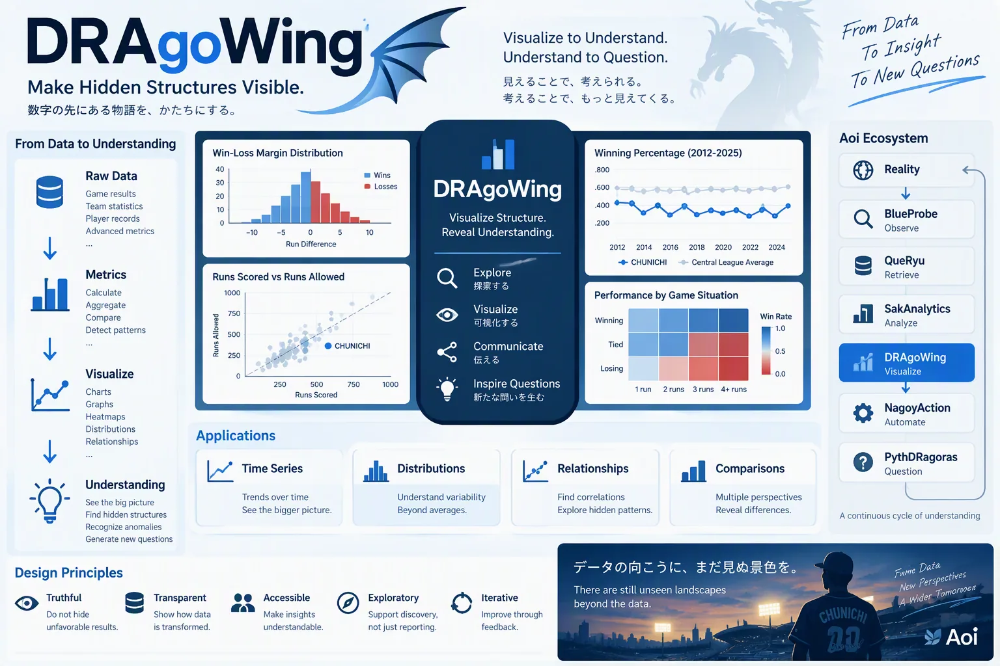
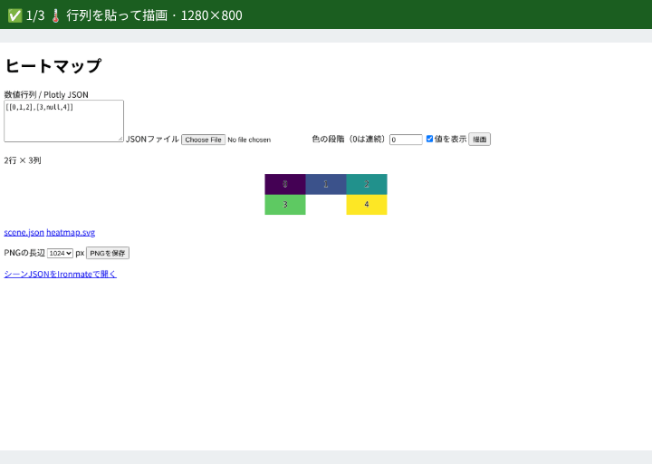

# DRAgoWing

<p align="center">
  
</p>

[Icon](https://myon-bioinformatics.github.io/DRAgoWing/icon.png) · [Favicon](https://myon-bioinformatics.github.io/DRAgoWing/favicon.png)

> Lay down the record without re-judging it.
>
> Renders baseball research records as Plotly.js HTML reports, proposition tables and optional SVG files drawn by the parent's standard-library `plotly_min` (no browser), without Python plotting libraries. Split out from Aoi's dragowing/ (git subtree).



*Concept image (a figure for sharing the idea; not the actual data or HTML structure)*

## Role in Aoi

**Visualization and reports.**

| Challenges | Approach | Outcomes & value |
|---|---|---|
| Records are scattered and hard to reproduce | 1. Read the records | Easy-to-read reports |
| Aggregated information is hard to summarize | 2. Render them as figures and tables | Sharing through HTML |
| Reports need continuous updating | 3. Convert them to HTML | Continuous report generation |

Topics: reports, HTML, visualization

## Overview

Turns recorded results (`season.jsonl` and `propositions.jsonl`) into figures and tables without redoing the judgment. No fitting, smoothing, or rounding into bins.

The text table of the four forms is in [docs/forms.md](docs/forms.md). HTML (trajectories, team × year, condition overlap, list of propositions) is in [docs/figures.md](docs/figures.md). The concept figure is [docs/images/dragowing.webp](https://github.com/myon-bioinformatics/Aoi/blob/main/docs/images/dragowing.webp).

It produces `index.html` and `propositions.html` in `--out` (a new temporary directory when omitted; the printed links open them). The trajectories, team × year, and condition overlap (grid and breakdown) in `index.html` are drawn from Plotly JSON specs with the browser's plotly.js (the latest dist on jsDelivr). The Python `plotly` package is not used. `propositions.html` is a list and Markdown tables, without Plotly. Add `--embed` to embed Plotly.js into `index.html`. Page text is converted from Markdown to HTML.

🖼️ SVG is optional: `--svg` writes `svg/<figure>.svg` with the parent's standard-library [`plotly_min`](https://github.com/myon-bioinformatics/myon-bioinformatics/blob/main/docs/plotly-min.md) (`vendor/tools/stdlib_min/plotly_min.py`). No Chrome / Chromium is used. PNG is not written here; screenshots belong to [BrowserTestKit](https://github.com/myon-bioinformatics/BrowserTestKit).

This repository was split out from the [Aoi](https://github.com/myon-bioinformatics/Aoi) subproject [`dragowing/`](https://github.com/myon-bioinformatics/Aoi/tree/main/dragowing) (see "Relationship with Aoi" below).

## Installation and usage

### Standalone HTML inspection

🐉 `dragowing.py` is the whole of DRAgoWing in one standard-library file (reports, four forms, FFSS figures, element counts). Counting elements in any saved UTF-8 HTML document and rendering the four-form text from JSONL records need no sibling modules:

```bash
python dragowing.py page.html --tag p --tag img
cat page.html | python dragowing.py - --tag p
uv tool install .   # or: uv tool install git+https://github.com/myon-bioinformatics/DRAgoWing.git
dragowing page.html --tag p
```

The tool project contains only `dragowing.py` and build metadata, and its runtime has no external Python dependencies. HTML reports and SVG also read `vendor/` (`markdown.py`, `plotly_min`), so run them from a checkout. Rebuild the tool project after changing `dragowing.py`.

For example, after installing the tool:

```bash
printf '<p>one</p><p>two</p>' | dragowing -
# {"img": 1, "p": 2}
printf '<p>one</p><p>two</p>' | dragowing --tag p
# {"p": 2}
dragowing missing.html  # reports a read error; exit 1
```

### 📊 FluidFullSpeedSimulation's still figures

[FluidFullSpeedSimulation](https://github.com/myon-bioinformatics/FluidFullSpeedSimulation) draws flows that change over time as GIFs, and leaves its still figures to this repository as records (`run E30` / `E31` / `E32 --jsonl`). `python dragowing.py --ffss RECORDS.jsonl --out DIR` writes `ffss.html` (plotly.js from the CDN) and `svg/F01_energy-coal.svg` … `F09_blood-flow.svg` without Chrome: the SVG is drawn by the parent's standard-library [`plotly_min`](https://github.com/myon-bioinformatics/myon-bioinformatics/blob/main/docs/plotly-min.md), locked at `vendor/tools/stdlib_min/plotly_min.py`. The figures lay down the record values as they are (fuel 100 Sankey diagrams, losses waterfall, HRSG T–Q, heat-pump balance point, start-up Gantt, sensitivity tornado, warm-up window heatmap, cardiac output Sankey); a record that is missing just leaves its figure out. `--no-svg` writes the HTML only. This needs `vendor/` next to `dragowing.py` (a checkout). See [FFSS input contract and verification](docs/ffss.md).

Without installation, replace `dragowing` with `python dragowing.py`. A path ending in `.html` / `.htm` (or `-` for stdin, or `--tag` alone) counts opening tags; a directory is `RESULTS` for the reports below.

Requires Python 3.11+ and [uv](https://docs.astral.sh/uv/). 📦 There are no runtime dependencies: page text goes through our own [`markdown.py`](https://github.com/myon-bioinformatics/markdown) (`vendor/markdown/markdown.py`, locked in `vendor.lock.json`) and SVG through the parent's `plotly_min`. 🧮 polars and numpy are in the `dev` group: only `--overlap-backend native` (PythDRagoras's `rule_search`) uses them. Figures use the browser's plotly.js; neither matplotlib nor Python plotly is installed. HTTP uses only the standard library's urllib (no httpx).

```bash
git clone https://github.com/myon-bioinformatics/DRAgoWing.git
cd DRAgoWing
uv sync
```

```bash
python -m dragowing RESULTS [--out DIR] [--id ID ...] [--column COLUMN] [--cond col,op,VALUE ...] [--breakdown COLUMN] [--breakdown-keep VALUE ...] [--svg] [--embed]
python dragowing.py RESULTS ...        # the same main
python dragowing.py RESULTS --forms --id P1   # 🧾 four-forms 2×2 as text (docs/forms.md)
```

- `RESULTS` is a directory containing `season.jsonl` and `propositions.jsonl`. Without `--out`, HTML goes to a new temporary directory. Each written file is printed as a `file://` link with its size (📄), after a 📦 line naming the vendored `markdown.py`. `--id` narrows propositions, and `--column` chooses the numeric column for team × year (default `wins_vs_pythag`).
- Repeat `--cond` to display 2–8 sets including class B. `--breakdown` selects the breakdown column (default `team`); repeat `--breakdown-keep` to keep values separate from “Other”. See [docs/figures.md](docs/figures.md).
- The native overlap path (`overlap.py`) uses `propositions` and `rule_search` from [PythDRagoras](https://github.com/myon-bioinformatics/PythDRagoras), and the four-forms table uses `ask` (registration status) from [QueRyu](https://github.com/myon-bioinformatics/QueRyu). DRAgoWing does not look for them: the caller puts them on the import path, and in Aoi that is `aoi.py` (`python aoi.py dragowing/__main__.py RESULTS`, `import aoi`, or `eval "$(python aoi.py)"` for one shell). When one is missing, the error names `aoi.py`.
- This directory is the contents of the `dragowing` package, so run `python -m dragowing` from a parent where the directory appears as `dragowing` (see the example under "Tests"), or run the file directly: `python aoi.py dragowing/__main__.py RESULTS` inside Aoi, or `eval "$(python /path/to/Aoi/aoi.py)"` and then `python /path/to/dragowing/__main__.py RESULTS` for a standalone checkout (`__main__.py` registers its directory as the `dragowing` package). `python aoi.py -m dragowing` is not the report: Aoi's import path includes this directory, so `dragowing` there is `dragowing.py`.

## Making only the overlap computation lightweight

`load_overlap(path, conds, backend="stdlib")` selects a limited path that does not load NumPy or Polars.
The CLI uses it by default, so its supported scalar inputs need only the standard library.
Use `--overlap-backend native` explicitly for the broader native input domain (NumPy/Polars required).
The legacy `--results DIR` spelling and `--overlap-backend stdlib` remain accepted.
Do not supply both `RESULTS` and `--results`. With no explicit backend, positional `RESULTS` selects stdlib, while legacy `--results DIR` retains native. An explicit `--overlap-backend` overrides either default.
`native` remains the `load_overlap` API default (NumPy, Polars and PythDRagoras's `rule_search`); the API is unchanged.
Supported input, limitations, and comparison measurements are in [docs/overlap-stdlib.md](docs/overlap-stdlib.md).
Markdown for HTML is still needed.

## Layout

| File | Contents |
|---|---|
| `dragowing.py` | 🐉 The single file (standard library only). 📈 `RESULTS` → `index.html` / `propositions.html` (and `svg/` with `--svg`), 🧾 `--forms` (four-forms 2×2 as text), 📊 `--ffss RECORDS`, 🔢 `PAGE.html` (element counts). Sections: records, Plotly.js CDN, four forms, overlap (stdlib path), figures (trajectory, team × year, FFSS, SVG via `plotly_min`), Venn grid, HTML (`markdown.py`), research report, CLI. Every function is callable by name (`main`, `load_overlap`, `heatmap_figure`, `render_report`, `write_ffss`, …) |
| `overlap.py` | α: the native overlap path (NumPy, Polars and PythDRagoras's `rule_search`, the `dev` group). `dragowing.overlap.load_overlap` keeps `native` as its default and re-exports the condition helpers; Aoi's shrink research uses it as its entry (`dragowing/overlap.py:load_overlap`) |
| `__main__.py` | `python -m dragowing` (the same `main` as `python dragowing.py`) |
| `conftest.py`, `tests/` | pytest (`conftest.py` registers this directory as the `dragowing` package) |
| `vendor/` | Our `markdown.py` (`vendor/markdown/`), the parent's `plotly_min` and shared contract checks, the Aoi shared tool `numpy_min.py`; locked in `vendor.lock.json` |
| `scripts/`, `reports/`, `docs/` | Vendor-lock check, benchmarks and the stdlib-substitute experiment; Aoi-side report building; docs |

## Tests

Cycle data (outputs in `cycles/`), [PythDRagoras](https://github.com/myon-bioinformatics/PythDRagoras) (`propositions` and `rule_search`), and [QueRyu](https://github.com/myon-bioinformatics/QueRyu) (`ask`) stay in Aoi. They are not copied; Aoi's main is checked out and passed in.

```bash
git clone https://github.com/myon-bioinformatics/Aoi.git .test-deps/aoi
git -C .test-deps/aoi checkout main   # CI resolves main's SHA at run time and checks it out
AOI_ROOT=$PWD/.test-deps/aoi uv run --locked pytest -q --junitxml=reports/junit.xml
```

- DRAgoWing does not know Aoi's layout. It takes the results directory and (if needed) `--team-order` explicitly. Tests use `aoi_paths.py` from the Aoi at `AOI_ROOT` to locate data.
- If `AOI_ROOT` does not point to Aoi (no `cycles/`), pytest stops first and prints the reason.
- This directory is the contents of the `dragowing` package (no `__init__.py`; `overlap.py` imports `from .dragowing`). Tests use `from dragowing.dragowing import …` (and `dragowing.overlap` for the native path) and `python -m dragowing`. pytest's `pythonpath` is `["."]`, and the top-level `conftest.py` registers this directory as `sys.modules["dragowing"]` (with `__path__` set to this directory) only when `dragowing` cannot yet be imported from the same directory. In Aoi the parent is on pythonpath and the same directory is already `dragowing`, so this registration does nothing.
- To run the CLI outside pytest, run Aoi's `aoi.py` first (it exports `AOI_ROOT` and the import paths for this shell only), then `__main__.py`. `__main__.py` registers its directory as the `dragowing` package whatever the checkout is named.

```bash
eval "$(python .test-deps/aoi/aoi.py)"
uv run --locked python __main__.py "$AOI_ROOT/cycles/c001-chunichi/outputs"
```

- In addition, the tests use the following from the Aoi at `AOI_ROOT`:
  - Output in `cycles/` (`cycles/c001-chunichi/outputs`).
  - `aoi.py`: `conftest.py` appends the import paths it gives (`aoi.environment()`, the same list as Aoi's pytest `pythonpath`) after this repository, so PythDRagoras's `propositions` / `rule_search` and QueRyu's `ask` import by name. DRAgoWing names neither directory.
  - `tests/test_no_sibling_imports.py` checks that no other Aoi sibling subprojects or `scripts/` are used (imports of `propositions`, `rule_search` and `ask` in the tests are known exceptions).
- Test files are named by purpose (`tests/test_<topic>.py`, e.g. `test_figures.py`, `test_venn.py`, `test_forms.py` for those sections of `dragowing.py`; `test_dragowing.py` for the standalone file and FFSS), `tests/test_fleet.py` for the contracts shared across repositories (vendor lock, parent pins, benchmark guards, CI jobs) through `vendor/fleet_check.py`, and `tests/test_vendor_lock.py` for `scripts/check_vendor_lock.py`.
- `reports/build_reports.py` is an Aoi-side tool (Aoi's DRAgoWing reports workflow checks out `myon-bioinformatics/markdown` and calls it). This repository's CI does not run that workflow.
- 🖼️ The Python matrix installs no browser: SVG comes from `plotly_min`, and the tests check that the CI job has no Chrome / Chromium step.

CI (`.github/workflows/ci.yml`) runs pytest on Python 3.11–3.15. Python is provisioned with `astral-sh/setup-uv`; the fixed lanes (`vendor-lock`, `vendor-dispatch`) run on 3.15 and the matrix keeps the compatibility range. `vendor.lock.json` (`vendor-lock/1`) records repository, ref, commit, source, destination, blob_sha, and sha256, and the copies are in `vendor/aoi/`. CI resolves Aoi's main with `git ls-remote` (overridable with `workflow_dispatch`'s `aoi-ref`), checks repository id `1402862784`, and then compares the copies. A mismatch is a warning on pull requests and a failure on pushes to main and on schedule. In parallel, it resolves the main of the parent myon-bioinformatics/myon-bioinformatics with `git ls-remote` (repository id `638801160`) and verifies that SHA's `pilot/vendor_dispatch.py` against `vendor.lock.json`. `--record` is not passed. Skips are recorded, and it fails if the recorded commit's digest differs.

## Relationship with Aoi

This repository was split out from the [Aoi](https://github.com/myon-bioinformatics/Aoi) subproject [`dragowing/`](https://github.com/myon-bioinformatics/Aoi/tree/main/dragowing).
Its parent is Aoi (Aoi's parent is [myon-bioinformatics](https://github.com/myon-bioinformatics/myon-bioinformatics)). It is registered in Aoi's [`child-heads.json`](https://github.com/myon-bioinformatics/Aoi/blob/main/child-heads.json), and its tree is the same as Aoi's `dragowing/` at the time of registration (including `.github/`, `pyproject.toml`, `uv.lock`, `conftest.py`, `.gitignore`, `LICENSE`, and this README). It is synced with `git subtree` (see "Syncing with Aoi" below; the full procedure is in Aoi's [docs/child-repositories.md](https://github.com/myon-bioinformatics/Aoi/blob/main/docs/child-repositories.md)).
This README starts from the same file as Aoi's `dragowing/README.md`. Links to documents and data inside Aoi are written as GitHub URLs so they open from either place.

### Syncing with Aoi

This repository is a subtree of Aoi's `dragowing/`. No files are excluded, and the tree of Aoi's `dragowing/` is the same as this repository's tree. Inside Aoi, `dragowing/.github/` does not run (GitHub reads only the repository's top-level `.github/`), and `dragowing/conftest.py` checks `AOI_ROOT` in Aoi's pytest the same way and does no package registration.

- History was split out, preserving history, from `dragowing/` at Aoi `a8dc4997f43236b24a23df56e21f143fa0e233d8` (main) (main `c789da2e30b33144f3110506f90f91ea579b9a6b`; the tree at split time, `70424b5a2768f43633766435cc9552f77c1b2ba7`, is the same as Aoi's `dragowing/`).
- This history is not connected to Aoi's history, so a join is added to Aoi once. A squash commit with this repository's main commit in `git-subtree-split:` (tree the same as this repository) becomes the second parent of a merge that does not change Aoi's tree. After the join, `git subtree` uses it as the starting point.
- The join must remain as the second parent. Aoi PRs containing the join are merged with a merge commit, not squashed (squashing drops the second parent, and `git subtree pull` and `split` stop working).
- The `git-subtree-split:` commit must be on this repository's main. Merge this repository's PRs with a merge commit too, not squash (squashing changes main's sha, so the sha written in `git-subtree-split:` doesn't stay on main).

Child → Aoi (on a branch created from Aoi's main):

```bash
git subtree pull --prefix=dragowing https://github.com/myon-bioinformatics/DRAgoWing.git main --squash
test "$(git rev-parse HEAD:dragowing)" = "$(git rev-parse FETCH_HEAD^{tree})"   # when Aoi has no unsynced changes
```

Aoi → child (on Aoi's main):

```bash
git fetch https://github.com/myon-bioinformatics/DRAgoWing.git main   # have the split's starting commit locally
git subtree split --prefix=dragowing -b sync/dragowing
test "$(git rev-parse sync/dragowing^{tree})" = "$(git rev-parse HEAD:dragowing)"
git push https://github.com/myon-bioinformatics/DRAgoWing.git sync/dragowing:refs/heads/<new-branch>
```

- Open a PR in this repository from the pushed branch. After merging, do the "Child → Aoi" pull in Aoi to re-anchor Aoi's starting point to this repository's main (a squash merge would not keep the split commit on main).
- Aoi's `scripts/check_child_heads.py --fail-on-diff` compares the tree of the sha registered in Aoi's `child-heads.json` with Aoi's `dragowing/`.

## Related subprojects

Each subproject of the parent [Aoi](https://github.com/myon-bioinformatics/Aoi) is its own repository. They are listed with their location in Aoi (subtree). The list and registration details are in Aoi's [docs/child-repositories.md](https://github.com/myon-bioinformatics/Aoi/blob/main/docs/child-repositories.md).

| Repository | Location in Aoi | Role |
|---|---|---|
| [BlueProbe](https://github.com/myon-bioinformatics/BlueProbe) | [`blueprobe/`](https://github.com/myon-bioinformatics/Aoi/tree/main/blueprobe) | Observation and extraction (reads saved HTML/CSS/DOM and records what is there) |
| [QueRyu](https://github.com/myon-bioinformatics/QueRyu) | [`queryu/`](https://github.com/myon-bioinformatics/Aoi/tree/main/queryu) | Fetching and building observation datasets (caches with provenance) |
| [SakAnalytics](https://github.com/myon-bioinformatics/SakAnalytics) | [`sakanalytics/`](https://github.com/myon-bioinformatics/Aoi/tree/main/sakanalytics) | Metrics and statistics from observation data (team × season metrics, outlook for remaining games) |
| [PythDRagoras](https://github.com/myon-bioinformatics/PythDRagoras) | [`pythdragoras/`](https://github.com/myon-bioinformatics/Aoi/tree/main/pythdragoras) | Verifying explanations (propositions, counterexamples, objections) |
| [NagoyAction](https://github.com/myon-bioinformatics/NagoyAction) | [`nagoyaction/`](https://github.com/myon-bioinformatics/Aoi/tree/main/nagoyaction) | Pipeline execution and automation (the same definition locally and on GitHub Actions) |
| **DRAgoWing** (this repository) | [`dragowing/`](https://github.com/myon-bioinformatics/Aoi/tree/main/dragowing) | Figures and reports (Plotly.js HTML, the four-forms table) |

## License

MIT License ([LICENSE](LICENSE)). `LICENSE` has the same contents as the MIT LICENSE at Aoi's root (blob `4ec4989b801bf1a3df6184d21f79e6e7ed5931f6`, 1061 bytes; Copyright (c) 2026 myon).

---

# Using it in Aoi's research cycle (Chunichi, NPB)

An example of building HTML from the c001 (Chunichi) output at Aoi's root.

```bash
python aoi.py dragowing cycles/c001-chunichi/outputs \
  --team-order d,g,s,db,t,c,h,f,b,e,l,m   # order is Aoi's setting (TEAM_ORDER in aoi_npb.py)
```

## Connecting with the existing Markdown implementation

The [DRAgoWing reports workflow](https://github.com/myon-bioinformatics/Aoi/blob/main/.github/workflows/dragowing.yml) checks out the latest main of `myon-bioinformatics/markdown` once on PRs, main updates, and manual runs, then renders research documents with `dragowing/reports/build_reports.py`. The docs-only skip for regular pytest is kept, and report generation runs even for docs-only changes.

Local example (point the output at an empty directory):

```sh
git clone https://github.com/myon-bioinformatics/markdown.git .deps/markdown
python -S dragowing/reports/build_reports.py --markdown-root .deps/markdown --output build/dragowing --previous-ref HEAD~1
```

### ヒートマップ

[ヒートマップを開く](https://myon-bioinformatics.github.io/tools/heatmap/)（ポートフォリオの 🧰 Tools。公開時に `scripts/build_heatmap_page.py` で組む）。このリポジトリの Pages は [利用ガイド](https://myon-bioinformatics.github.io/DRAgoWing/)（🎞 GIF デモ / 🧩 機能一覧）。



行列・CSV/TSV または Plotly heatmap を貼り付けるか、ファイルを開く（サンプルデータ切替・ブラウザ内下書き保存対応）。
配色パレット・段階数・`zmin`/`zmax`・値の表示・転置/上下反転・軸ラベル/凡例を調整し、統計サマリー・数値テーブル・セル詳細を確認して、SVG / CSV / PNG / PNG Base64 または Image Studio で編集できるシーン JSON を保存・コピーする。欠測セルは透明のまま書き出す（見た目は PySaiyanWeBoo のテーマ切替に対応）。
同じシーンを CLI から生成するには `python -S dragowing.py --heatmap matrix.json > scene.json`。

## 核酸・タンパク質の原子座標

SSIS の `structure --output graph` が出力する JSON を回転・拡大できる 3D 図にします。

```sh
python -S dragowing.py --structure-graph model.json --embed > model.html
```

`-` で標準入力からも読み込めます。各点は元素別の原子、線は SSIS が抽出した残基間の接触候補です。点にカーソルを置くと鎖・残基・原子名と座標（Å）、線では候補の種類と距離が読めます。`--embed` は生成時に Plotly.js を取得して HTML に含めます。
