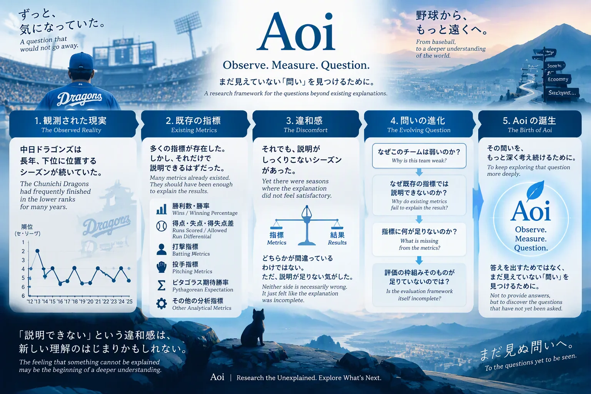
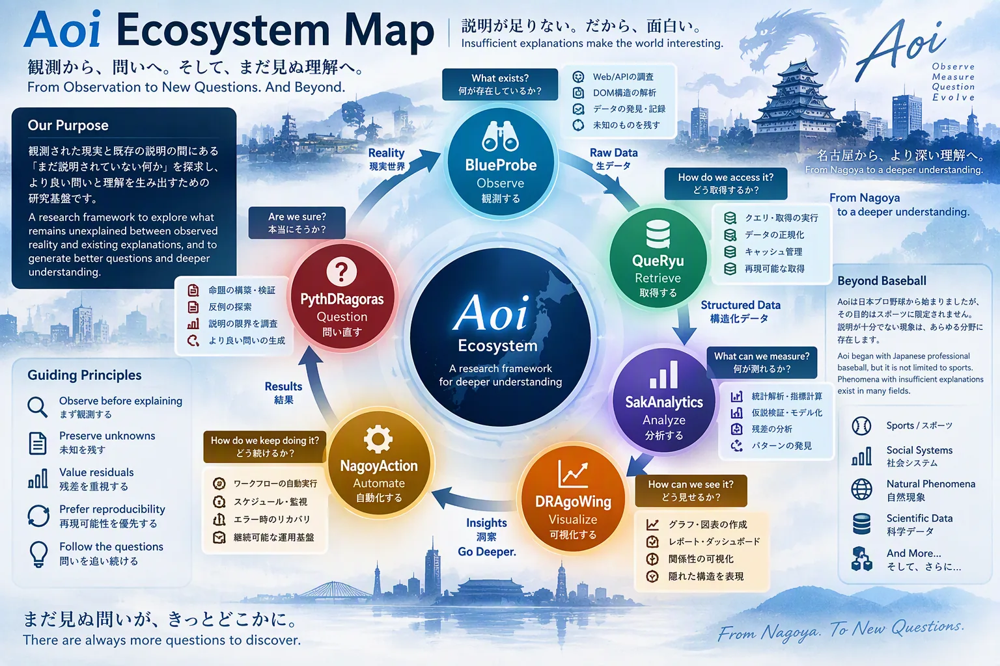
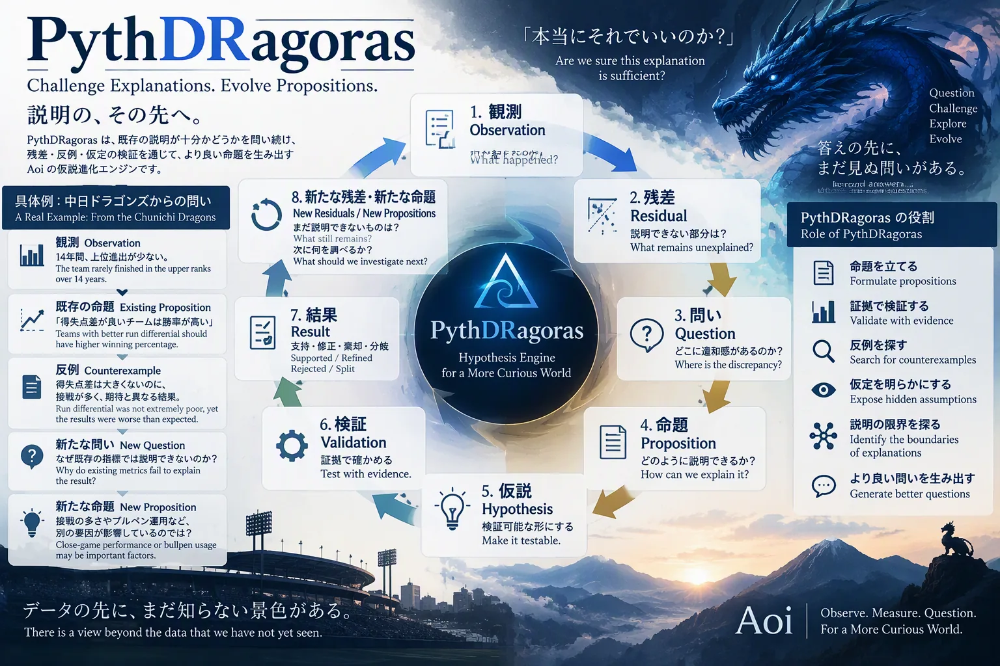

# Aoi

> Observe. Measure. Question.

Aoi is a hypothesis-driven research framework that explores situations where observed reality cannot be fully explained by existing analytical models.

The project began with a simple observation:

> Some outcomes repeatedly occurred even when existing explanations felt incomplete.

Although Aoi originated from the observation of long-term patterns in Japanese professional baseball, baseball is not the destination.

Baseball is the laboratory.

The actual subject of Aoi is explanation itself.

Aoi is also a working repository: a uv-managed Python project that holds the research cycles (data, configurations and findings) and the subprojects that observe, retrieve, measure, validate, visualize and automate them. Each subproject is also published as its own repository (see [Child Repositories](#child-repositories)).

## Getting Started

Requirements: Python 3.11 or newer (`.python-version` pins 3.14 for local work) and [uv](https://docs.astral.sh/uv/).

```bash
git clone https://github.com/myon-bioinformatics/Aoi.git
cd Aoi
uv sync
uv run --locked pytest -q
```

Runtime dependencies (`pyproject.toml`): polars, httpx, selectolax, numpy and markdown. Development dependencies: pytest and coverage. Figures are drawn in the browser with plotly.js; matplotlib and the Python plotly package are not used.

A research cycle is described once as a pipeline and runs the same way locally and on GitHub Actions ([NagoyAction](https://github.com/myon-bioinformatics/NagoyAction)):

```bash
python nagoyaction/nagoyaction.py doctor cycles/c001-chunichi/pipeline.toml            # pre-flight check
python nagoyaction/nagoyaction.py run    cycles/c001-chunichi/pipeline.toml --dry-run  # show what would run
```

## Repository Layout

| Path | Contents |
|---|---|
| [`blueprobe/`](blueprobe/) | BlueProbe: observation and extraction from saved HTML/CSS/DOM. Also published as [BlueProbe](https://github.com/myon-bioinformatics/BlueProbe) |
| [`queryu/`](queryu/) | QueRyu: retrieval, provenance-tracked cache and observation datasets. Also published as [QueRyu](https://github.com/myon-bioinformatics/QueRyu) |
| [`sakanalytics/`](sakanalytics/) | SakAnalytics: team × season metrics and statistics; remaining-season forecasts. Also published as [SakAnalytics](https://github.com/myon-bioinformatics/SakAnalytics) |
| [`pythdragoras/`](pythdragoras/) | PythDRagoras: propositions, counterexamples and explanation validation. Also published as [PythDRagoras](https://github.com/myon-bioinformatics/PythDRagoras) |
| [`dragowing/`](dragowing/) | DRAgoWing: figures and reports (Plotly.js HTML, four-form tables). Also published as [DRAgoWing](https://github.com/myon-bioinformatics/DRAgoWing) |
| [`nagoyaction/`](nagoyaction/) | NagoyAction: pipelines and automation (same definition locally and on GitHub Actions). Also published as [NagoyAction](https://github.com/myon-bioinformatics/NagoyAction) |
| [`cycles/`](cycles/) | Research cycles: configuration, outputs and research records. The first cycle is [`cycles/c001-chunichi/`](cycles/c001-chunichi/README.md) (Chunichi Dragons, NPB) |
| [`research/`](research/) | Standalone research notes (for example [`research/gpt-r001-score-allocation/`](research/gpt-r001-score-allocation/README.md)) |
| [`research_loop/`](research_loop/README.md) | Automated exploration and HTML observation that connect several subprojects |
| [`scripts/`](scripts/) | Repository-level tools (child registry check, distribution build, c001 replay and publication) |
| [`dist/`](dist/), [`distributions/`](distributions/), `distributions.json` | Single-file stdlib distributions (`*_min.py`); see [docs/distributions.md](docs/distributions.md) |
| [`vendor/`](vendor/), `vendor.lock.json` | Pinned single-file copies from other repositories, verified by hash |
| [`docs/`](docs/) | Philosophy, principles, method and specifications |
| [`tests/`](tests/) | Repository-level tests (each subproject keeps its own `tests/`) |
| `child-heads.json` | Registered heads of the child repositories; see [docs/child-repositories.md](docs/child-repositories.md) |
| `aoi_paths.py` | Shared repository-layout helpers (mirrored into the child repositories) |

## Child Repositories

Each subproject lives in Aoi as a directory and is also published as a standalone repository. Changes move between the two with `git subtree` (history is shared; see [docs/child-repositories.md](docs/child-repositories.md)). Each child README links back here and to its siblings.

| Project | Repository | Directory in Aoi | Registered in |
|---|---|---|---|
| BlueProbe | [myon-bioinformatics/BlueProbe](https://github.com/myon-bioinformatics/BlueProbe) | [`blueprobe/`](blueprobe/) | Aoi `child-heads.json` |
| QueRyu | [myon-bioinformatics/QueRyu](https://github.com/myon-bioinformatics/QueRyu) | [`queryu/`](queryu/) | Aoi `child-heads.json` |
| SakAnalytics | [myon-bioinformatics/SakAnalytics](https://github.com/myon-bioinformatics/SakAnalytics) | [`sakanalytics/`](sakanalytics/) | Aoi `child-heads.json` |
| PythDRagoras | [myon-bioinformatics/PythDRagoras](https://github.com/myon-bioinformatics/PythDRagoras) | [`pythdragoras/`](pythdragoras/) | Aoi `child-heads.json` |
| DRAgoWing | [myon-bioinformatics/DRAgoWing](https://github.com/myon-bioinformatics/DRAgoWing) | [`dragowing/`](dragowing/) | Aoi `child-heads.json` |
| NagoyAction | [myon-bioinformatics/NagoyAction](https://github.com/myon-bioinformatics/NagoyAction) | [`nagoyaction/`](nagoyaction/) | Aoi `child-heads.json` |

The copy inside Aoi and the standalone repository can drift between syncs; the registered heads are checked with `python -S scripts/check_child_heads.py --fail-on-diff`.

## Tests

```bash
uv run --locked pytest -q                         # tests/ and every subproject's tests/ (pyproject.toml testpaths)
python -S nagoyaction/linkcheck.py                # Markdown links and images (tracked files, exact case)
python -S scripts/check_child_heads.py --fail-on-diff   # child repositories vs. their directories in Aoi
```

CI (`.github/workflows/ci.yml`) runs pytest on Python 3.11–3.15; the Links workflow runs the link check on every change, including docs-only changes.

## License

MIT License. See [LICENSE](LICENSE) (Copyright (c) 2026 myon). The child repositories carry the same MIT license text.

---

<!-- IMAGE 01:
Why Aoi Exists

A team keeps losing
↓
Current metrics explain part of reality
↓
The explanation still feels incomplete
↓
What is missing?
↓
Aoi
-->



*イメージ図（構想を共有するための図。実際のデータ・HTML構造ではない）*

## Why Aoi Exists

Aoi was not created to prove existing metrics wrong.

Aoi was created because existing explanations occasionally felt incomplete.

At first, the question was:

> Why does this team keep losing?

Over time, the question evolved:

> Why do existing metrics fail to fully explain the result?

And eventually:

> If reality repeatedly disagrees with an explanation, should the explanation itself be questioned?

That question became the origin of Aoi.

---

## Start Here

If you are new to Aoi, read these documents first.

### Core Documents

- [docs/GENESIS.md](docs/GENESIS.md)
- [docs/philosophy.md](docs/philosophy.md)
- [docs/principles.md](docs/principles.md)

These documents explain:

- why Aoi exists
- how Aoi thinks
- how contributors should make decisions
- what assumptions should be challenged
- what assumptions should be preserved

---

<!-- IMAGE 02:
Research Cycle

Observation
↓
Analysis
↓
Explanation
↓
Contradiction
↓
Hypothesis
↓
Validation
↓
New Observation
-->


## Research Cycle

Most analytical systems stop after producing a conclusion.

Aoi intentionally continues beyond that point.

Observation leads to analysis.

Analysis leads to explanation.

Explanations eventually encounter contradictions.

Contradictions generate hypotheses.

Hypotheses generate new observations.

The cycle continues.

Within Aoi, residuals, counterexamples, and unexplained outcomes are treated as opportunities for discovery.

---

## Core Ideas

### Observation Before Interpretation

Separate:

- what happened
- why it happened

These are different questions.

### Residuals Matter

Unexplained outcomes are not automatically noise.

They may indicate:

- hidden variables
- missing assumptions
- model limitations
- new evaluation frameworks

### Unknown Is Better Than Silent Failure

If something cannot be classified, report it.

Do not silently discard evidence.

### Models Are Tools, Not Truth

All models are incomplete.

The purpose of Aoi is not to defend models.

The purpose of Aoi is to understand their limits.

---

<!-- IMAGE 03:
Aoi Ecosystem

Aoi
├─ QueRyu
├─ BlueProbe
├─ SakAnalytics
├─ DRAgoWing
├─ NagoyAction
└─ PythDRagoras
-->



*イメージ図（構想を共有するための図。実際のデータ・HTML構造ではない）*

## Ecosystem

The Aoi ecosystem consists of multiple projects.

Each project focuses on a different stage of understanding reality.

| Project | Purpose | Repository | In Aoi |
|----------|----------|----------|----------|
| QueRyu | Query and execution | [QueRyu](https://github.com/myon-bioinformatics/QueRyu) | [`queryu/`](queryu/) |
| BlueProbe | Observation and discovery | [BlueProbe](https://github.com/myon-bioinformatics/BlueProbe) | [`blueprobe/`](blueprobe/) |
| SakAnalytics | Analysis and statistical methods | [SakAnalytics](https://github.com/myon-bioinformatics/SakAnalytics) | [`sakanalytics/`](sakanalytics/) |
| DRAgoWing | Visualization and reporting | [DRAgoWing](https://github.com/myon-bioinformatics/DRAgoWing) | [`dragowing/`](dragowing/) |
| NagoyAction | Automation and orchestration | [NagoyAction](https://github.com/myon-bioinformatics/NagoyAction) | [`nagoyaction/`](nagoyaction/) |
| PythDRagoras | Hypothesis generation and explanation validation | [PythDRagoras](https://github.com/myon-bioinformatics/PythDRagoras) | [`pythdragoras/`](pythdragoras/) |

Together they form a continuous research loop.

Observe.

Measure.

Analyze.

Visualize.

Question.

Repeat.

---

<!-- IMAGE 04:
Responsibilities

BlueProbe -> Observe
QueRyu -> Retrieve
SakAnalytics -> Analyze
DRAgoWing -> Visualize
NagoyAction -> Automate
PythDRagoras -> Challenge
-->


## Project Responsibilities

### QueRyu

Responsible for retrieval, querying, and execution.

Question:

> How do we obtain information reproducibly?

Repository: [QueRyu](https://github.com/myon-bioinformatics/QueRyu) (in Aoi: [`queryu/`](queryu/))

Documentation:

- [queryu/README.md](queryu/README.md)

---

### BlueProbe

Responsible for observation, exploration, parsing, and discovery.

Question:

> What actually exists in the source?

Repository: [BlueProbe](https://github.com/myon-bioinformatics/BlueProbe) (in Aoi: [`blueprobe/`](blueprobe/))

Documentation:

- [docs/observation.md](docs/observation.md)
- [blueprobe/README.md](blueprobe/README.md)

---

### SakAnalytics

Responsible for analytical methods and statistical reasoning.

Question:

> What patterns can be measured?

Repository: [SakAnalytics](https://github.com/myon-bioinformatics/SakAnalytics) (in Aoi: [`sakanalytics/`](sakanalytics/))

Documentation:

- [sakanalytics/README.md](sakanalytics/README.md)

---

### DRAgoWing

Responsible for visual communication.

Question:

> How do hidden structures become visible?

Repository: [DRAgoWing](https://github.com/myon-bioinformatics/DRAgoWing) (in Aoi: [`dragowing/`](dragowing/))

Documentation:

- 四つの形の 2×2 と条件の論理記号: [dragowing/docs/forms.md](dragowing/docs/forms.md)。軌跡・球団×年・条件の重なり・命題の一覧の HTML: [dragowing/docs/figures.md](dragowing/docs/figures.md)。構想図は [docs/images/dragowing.webp](docs/images/dragowing.webp)

---

### NagoyAction

Responsible for workflows and automation.

Question:

> How can research processes be repeated reliably?

Repository: [NagoyAction](https://github.com/myon-bioinformatics/NagoyAction) (in Aoi: [`nagoyaction/`](nagoyaction/))

Documentation:

- [nagoyaction/README.md](nagoyaction/README.md)

---

### PythDRagoras

Responsible for hypothesis generation and explanation validation.

Question:

> Are we sure this explanation is sufficient?

Unlike the rest of the ecosystem, PythDRagoras is not focused on producing answers.

Its purpose is to challenge assumptions, expose limitations, and generate better questions.

Repository: [PythDRagoras](https://github.com/myon-bioinformatics/PythDRagoras) (in Aoi: [`pythdragoras/`](pythdragoras/))

Documentation:

- [docs/PythDRagoras.md](docs/PythDRagoras.md)
- [docs/hypothesis.md](docs/hypothesis.md)
- [docs/validation.md](docs/validation.md)
- [pythdragoras/README.md](pythdragoras/README.md)

---

<!-- IMAGE 05:
PythDRagoras

Observation
↓
Explanation
↓
Residual
↓
New Hypothesis
↓
Validation
-->



*イメージ図（構想を共有するための図。実際のデータ・HTML構造ではない）*

## PythDRagoras

PythDRagoras is the philosophical center of the ecosystem.

Most analytical systems optimize for answers.

PythDRagoras optimizes for better questions.

When explanations appear complete, it searches for boundaries.

When models appear successful, it searches for exceptions.

When assumptions appear safe, it searches for contradictions.

Its role is not to protect explanations.

Its role is to challenge them.

---

## Contributing

Before contributing code, metrics, models, or assumptions:

Read:

- [docs/GENESIS.md](docs/GENESIS.md)
- [docs/philosophy.md](docs/philosophy.md)
- [docs/principles.md](docs/principles.md)

The philosophy of Aoi is more important than any individual implementation.

A technically correct implementation may still be incompatible with Aoi if it:

- hides uncertainty
- discards observations
- removes contradictions
- assumes existing explanations are sufficient

---

## Long-Term Vision

Aoi begins with baseball.

Aoi does not end with baseball.

The long-term goal is understanding:

- how explanations emerge
- how assumptions form
- how models fail
- how hypotheses evolve
- how new evaluation frameworks are discovered

The objective is not merely analysis.

The objective is understanding how understanding itself improves.

---

## Final Principle

Most analytical projects are built to provide answers.

Aoi is built to discover which questions have not yet been asked.

The project began because one explanation felt insufficient.

Everything that follows exists to explore why.

For the complete origin story, read:

→ [docs/GENESIS.md](docs/GENESIS.md)
