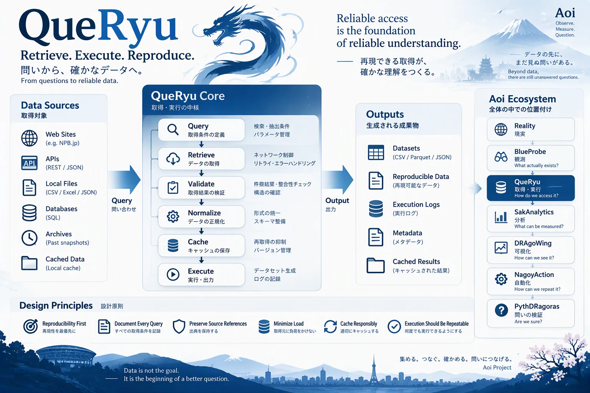
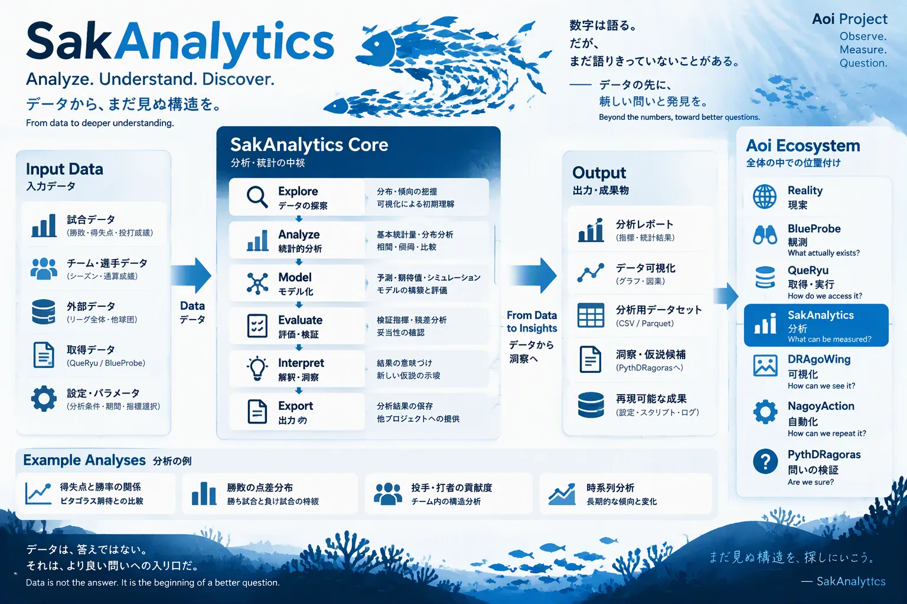
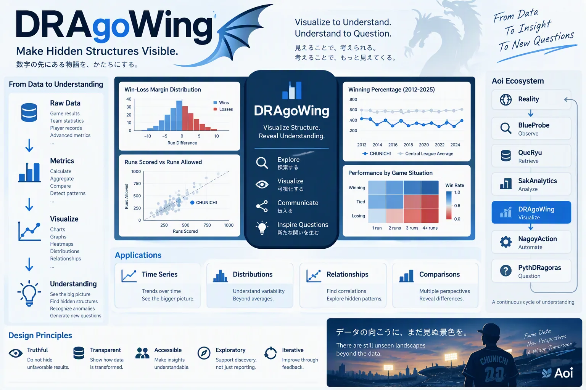
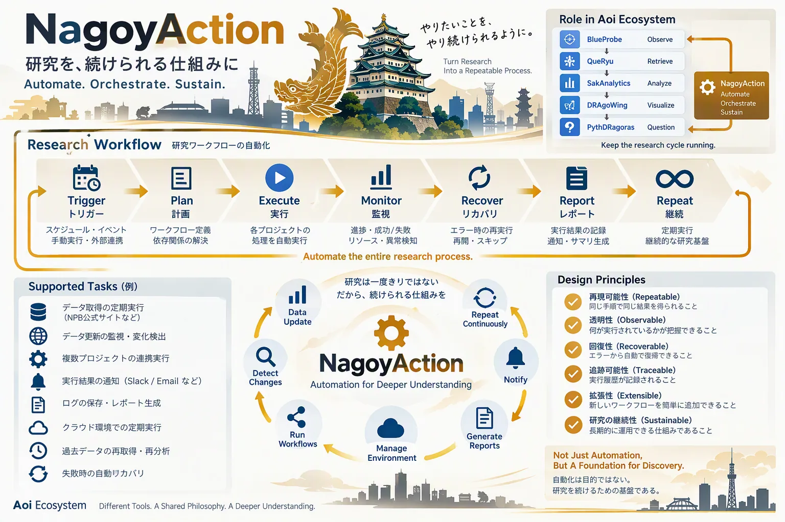

# Aoi Ecosystem

This document defines the structure of the Aoi ecosystem.

Aoi is intentionally designed as a collection of independent projects rather than a single monolithic application.

Each project exists to answer a different type of question.

Together, they form a continuous research and understanding cycle.

## Reading The Concept Diagrams

This page brings together the existing illustrations in [images/](images/) and their textual meaning. The diagrams describe responsibilities, handoffs and design intentions across domains. They are not evidence from a research run, actual source HTML, or a promise that every pictured source, output format or integration is implemented.

The baseball examples are illustrative. Research evidence belongs to its cycle, and the [data policy](data-policy.md) and [validation rules](validation.md) take precedence over an illustration. Use the implementation links in each section for supported behavior. In particular, a diagram does not authorize data collection, notifications, workflow activation or publication.

Jump to [BlueProbe](#blueprobe), [QueRyu](#queryu), [SakAnalytics](#sakanalytics), [DRAgoWing](#dragowing), [NagoyAction](#nagoyaction), or [PythDRagoras](#pythdragoras).

---

# Ecosystem Overview

The Aoi ecosystem currently consists of six primary projects.

```text
Reality
    │
    ▼

BlueProbe
    │
    ▼

QueRyu
    │
    ▼

SakAnalytics
    │
    ▼

DRAgoWing
    │
    ▼

PythDRagoras
    │
    ▼

New Questions
    │
    ▼

Reality
```

Automation and orchestration are provided by NagoyAction, which operates across the entire ecosystem.

---

# Design Philosophy

The ecosystem is not organized around technologies.

It is organized around understanding.

Each project owns a different stage of the research process.

This separation exists to prevent responsibilities from becoming mixed.

Observation is different from analysis.

Analysis is different from visualization.

Visualization is different from explanation.

Explanation is different from validation.

The ecosystem preserves these distinctions.

---

# BlueProbe


*構想図。図中の試合データと HTML は説明用であり、実際の観測結果ではありません。[画像を開く](images/blueprobe.webp)。*

## Purpose

Observation and discovery.

## Fundamental Question

> What actually exists?

BlueProbe is responsible for interacting with reality as directly as possible.

Its role is not to explain.

Its role is not to analyze.

Its role is to observe.

Examples:

- crawling
- parsing
- source inspection
- HTML analysis
- structure discovery
- cache inspection
- data acquisition research

BlueProbe prefers observation over interpretation.

Unknown structures should remain visible.

Unexpected structures should be reported.

## Evidence Handoff

The diagram's **Source → Observe → Discover → Preserve → Report → Evidence** flow describes how a source becomes inspectable evidence rather than an explanation.

- Inspect structure, locate records and expose unfamiliar patterns or notation.
- Preserve source context, raw observations and acquisition metadata so another observer can revisit the same material.
- Report accepted records, unclassified observations and limitations together. A failed extraction is not an empty observation.
- Prefer repeatable inspection and reuse saved material to minimize load on the source.

The implementation boundary matters: QueRyu handles network retrieval and its provenance-tracked cache; BlueProbe reads saved HTML/CSS/DOM and reports what it contains. The diagram's broad observation role does not move network retrieval into BlueProbe or turn observations into analytical judgments. See the [BlueProbe README](../blueprobe/README.md) and the [observation principles](observation.md).

---

# QueRyu



*構想図。取得元と出力形式は概念上の例であり、対応済み機能の一覧ではありません。[画像を開く](images/queryu.webp)。*

## Purpose

Retrieval and execution.

## Fundamental Question

> How can information be accessed reliably?

QueRyu sits between raw observations and analytical systems.

Its primary concern is reproducibility.

Examples:

- querying
- data loading
- execution pipelines
- dataset generation
- command interfaces
- reproducible extraction

QueRyu focuses on obtaining information consistently.

## Reproducible Retrieval

The diagram's **Query → Retrieve → Validate → Normalize → Cache → Execute** flow connects an explicit request to traceable data. It is a responsibility map, not a required execution order: reusable source material must be preserved before transformations, as required by the [data policy](data-policy.md).

- Record the request, source reference, acquisition time and code version.
- Check retrieval integrity and record transformations instead of silently repairing or discarding records.
- Reuse cached material, minimize source load and retain the information needed to repeat an extraction.
- Hand downstream tools a dataset together with its provenance and execution record.

In the documented implementation, QueRyu keeps cached bodies and acquisition history, and builds JSONL observation datasets with a manifest using BlueProbe sources. The SQL, spreadsheet, API and output-format labels in the illustration are not a general connector or export support matrix. Supported sources, cache behavior and commands are documented in the [QueRyu README](../queryu/README.md).

---

# SakAnalytics



*構想図。分析例は研究結果ではなく、図中の選手単位の例は現在のデータ方針を変更しません。[画像を開く](images/sakanalytics.webp)。*

## Purpose

Statistical and analytical reasoning.

## Fundamental Question

> What patterns can be measured?

SakAnalytics contains the analytical knowledge of the ecosystem.

Examples:

- statistics
- hypothesis testing
- residual analysis
- distributions
- prediction models
- evaluation metrics

SakAnalytics transforms observations into measurable structures.

## Analysis Handoff

The diagram's **Explore → Analyze → Model → Evaluate → Interpret → Export** flow connects recorded observations and explicit settings to measurable patterns and new questions.

- Keep the input dataset, comparison scope, parameters and transformations traceable.
- Examine distributions, differences, relationships and change over time without hiding missing or unexplained values.
- Keep model evaluation and interpretation distinguishable from the observations themselves.
- Pass recorded metrics to DRAgoWing and candidate explanations, residuals and limitations to PythDRagoras. An analytical pattern is not itself a validated explanation.

The illustration includes player records and pitcher/batter contributions as broad examples. Under [The Unit Is Observed As A Whole](data-policy.md#the-unit-is-observed-as-a-whole), member-level explanations are outside Aoi's current policy scope, not merely waiting for more data. The illustration does not expand that scope or approve new collection.

Implementation: [SakAnalytics README](../sakanalytics/README.md), including team × season metrics; [remaining-season simulation, CS probability and title magic](../sakanalytics/SEASON_SIMULATOR.md).

---

# DRAgoWing



*構想図。勝率・点差分布・散布図・ヒートマップの数値は説明用であり、研究の証跡として使いません。[画像を開く](images/dragowing.webp)。*

## Purpose

Visualization and communication.

## Fundamental Question

> How can understanding become visible?

Not every discovery is useful if it cannot be communicated.

DRAgoWing exists to make structures visible.

Examples:

- charts
- diagrams
- reports
- dashboards
- visual storytelling
- exploratory visualizations

DRAgoWing serves as the visual layer of Aoi.

## Visual Communication

The diagram's **Explore → Visualize → Communicate → Inspire Questions** flow makes recorded structures inspectable. Its examples span time series, distributions, relationships and comparisons; they illustrate ways to ask questions, not conclusions about a team or a supported chart catalogue.

- **Truthful:** preserve inconvenient outcomes, gaps and uncertainty.
- **Transparent:** show where values came from and which transformations produced them.
- **Accessible:** make labels, comparisons and context understandable.
- **Exploratory:** help readers notice structures and formulate questions, not only consume a report.
- **Iterative:** improve the presentation through feedback without rewriting the underlying evidence.

The raw-data-to-metrics panel spans upstream work as well: DRAgoWing presents recorded results rather than repeating the analysis or changing proposition verdicts. The current [README](../dragowing/README.md), [figure contract](../dragowing/docs/figures.md) and [four-form tables](../dragowing/docs/forms.md) define the implemented presentation behavior.

---

# NagoyAction



*構想図。監視・通知・自動復旧は運用上の概念を含み、既定で有効な機能を示すものではありません。[画像を開く](images/nagoyaction.webp)。*

## Purpose

Automation and orchestration.

## Fundamental Question

> How can research be repeated reliably?

NagoyAction manages execution across the ecosystem.

Examples:

- scheduled workflows
- orchestration
- automation
- pipelines
- operational tasks
- repeatable research processes

Its purpose is reliability rather than analysis.

## Repeatable Operations

The diagram's **Trigger → Plan → Execute → Monitor → Recover → Report → Repeat** flow describes the operational lifecycle around the other projects, not an additional analytical stage.

- **Repeatable:** make the procedure and its inputs explicit.
- **Observable and traceable:** record what ran, its outcome and its history.
- **Recoverable:** make failures visible and recovery deliberate; never silently skip missing evidence.
- **Extensible and sustainable:** allow new workflows without losing the ability to understand and maintain existing ones.

Scheduled acquisition, change detection, coordinated runs, notifications, reports and recovery are use-case examples in the illustration. The current runner's documented contract is narrower: preflight checks, explicit pipeline steps, receipts and stopping at a failed step. The diagram does not mean arbitrary Slack/email notifications, automatic recovery or a research worker are enabled. Configuration, permissions and the [publication gate](../nagoyaction/PUBLICATION.md) still apply. See the [NagoyAction README](../nagoyaction/README.md).

---

# PythDRagoras

## Purpose

Hypothesis generation and explanation validation.

## Fundamental Question

> Are we sure this explanation is sufficient?

PythDRagoras is unique within the ecosystem.

Every other project contributes toward understanding reality.

PythDRagoras contributes toward questioning understanding itself.

Examples:

- residual investigation
- contradiction analysis
- model validation
- hypothesis generation
- explanation boundaries
- assumption discovery

PythDRagoras is not an answer engine.

PythDRagoras is a question engine.

Its role is to identify:

- unexplained outcomes
- hidden assumptions
- model boundaries
- opportunities for new hypotheses

---

# Information Flow

A simplified view of ecosystem interactions:

```text
Reality
    │
    ▼

BlueProbe
Observe

    │
    ▼

QueRyu
Retrieve

    │
    ▼

SakAnalytics
Analyze

    │
    ▼

DRAgoWing
Visualize

    │
    ▼

PythDRagoras
Question

    │
    ▼

New Hypothesis

    │
    ▼

Reality
```

The cycle intentionally loops.

Understanding is never considered complete.

---

# Independence

Each project should remain independently usable whenever practical.

This provides several benefits:

- easier maintenance
- clearer responsibilities
- simpler testing
- better documentation
- future reuse outside Aoi

Projects may evolve separately while still sharing common philosophy.

---

# Shared Principles

Every ecosystem project must follow:

- GENESIS.md
- philosophy.md
- principles.md

Implementation details may differ.

The philosophy should remain consistent.

---

# Future Expansion

The ecosystem described here is not final.

New projects may emerge.

Existing projects may split.

Existing projects may merge.

The ecosystem should evolve when evidence suggests a better structure.

The objective is not stability.

The objective is understanding.

---

# Final Principle

The Aoi ecosystem exists because understanding is not a single activity.

Observation.

Retrieval.

Analysis.

Visualization.

Validation.

Questioning.

Each deserves its own tools.

Together they create a system capable of improving explanations rather than merely producing them.
